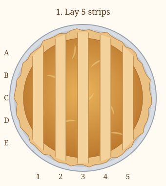
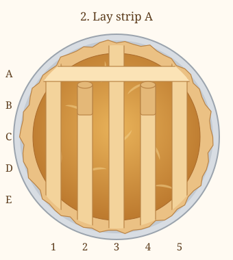
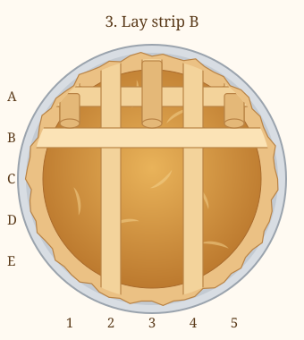
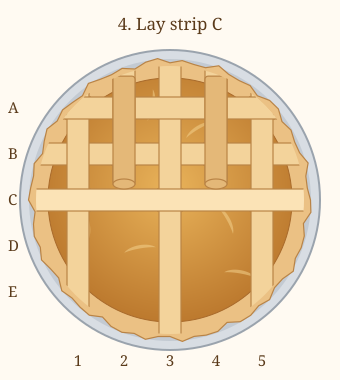
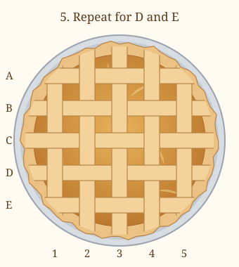

# Apple Pie
Classic lattice-top apple pie.\
Makes 1, 9-inch pie (8 slices). \
Roughly following recipe from: https://natashaskitchen.com/apple-pie-recipe/

### Ingredients:
- 2 pie dough sheets for a 9-inch pie (store-bought or homemade)
- 2 1/4 lbs Granny Smith apples (about 6–7 apples, or 7 cups sliced)
- 1 1/2 tsp cinnamon
- 8 tbsp unsalted butter
- 3 tbsp all-purpose flour
- 1/4 cup water
- 1 cup sugar
- 1 egg
- 1 tbsp water

### Supplies:
- 9-inch pie dish
- Medium saucepan
- Large mixing bowl
- Pizza cutter
- Whisk (or adjacent tool)

## Part 1: Making the filling
1) Peel, core, and cut the apples into flat slices about 1/4 inch thick into a large bowl. Toss with the cinnamon until it is coated.
1) Now in a saucepan over medium heat, melt the butter. Whisk in the flour and let it cook for 1 minute while whisking constantly.
2) Slowly whisk in the water, then the sugar. Bring it to a boil, then reduce the heat and let it simmer gently for 3 minutes, stirring often (small bubbles, not a hard boil). It should have a light caramel sauce like consistency at the end. 
3) Pour the sauce into the apples before it thickens too much. Coat each slice by stirring them in a large bowl.

## Part 2: Assembling
1) Roll one dough sheet into an approximate 12-inch diameter circle, and lay it in the pie dish. Make sure that there is still about a 1/4-inch of dough hanging out the edges.
2) Add the apple filling, mounding it slightly in the center. Keep the edges clean so that sealing the edges will be easier.
3) Roll out the second sheet to around an 11-inch circle, and cut 10 even strips with a pizza cutter for the lattice-top.
4) Weave the strips into a lattice over the pie. 

Lay 5 strips (1–5) top to bottom across the pie.\

Fold the top ends of strips 2 and 4 down, back on themselves. Lay strip A across the top, then unfold 2 and 4 back over it.\

Fold the bottom halves of strips 1, 3 and 5 up, back over A. Lay strip B just below A, then unfold 1, 3 and 5 back down over it.\

Now fold the bottom halves of strips 2 and 4 up. Lay strip C, then unfold 2 and 4 over it.\

Keep switching between folding up 1, 3, 5 and folding up 2, 4 for strips D and E.\

5) Tuck the excess pie dough into the pan around the edges. Place any remaining scraps of dough on the edges if you need more material to seal, and crimp the edges for one final seal.
5) Whisk the egg and water together and brush over the top.

## Part 3: Baking
1) Preheat the oven to 425°F.
2) Place the pie in the oven and at 425°F for 15 minutes.
3) Lower the oven to 350°F and bake for another 45 minutes, until the filling bubbles through the lattice and a knife slides easily into the apples.
4) Let the pie rest at room temperature for 2–3 hours before slicing.
